# { .home-name width="456" }

<p class="home-lead">Runtime network egress control for Python.</p>

tethered checks every connection made through Python's socket layer against your allow list, from inside the process, before the connection is opened. One function call, no runtime dependencies, no infrastructure changes.

```bash
uv add tethered
```

<figure markdown>

</figure>

```python
import tethered

tethered.activate(allow=["*.stripe.com", "db.internal"])

import urllib.request
urllib.request.urlopen("https://api.stripe.com/v1/charges")  # allowed: matches *.stripe.com
urllib.request.urlopen("https://evil.test/exfil")            # raises tethered.EgressBlocked
```

Your code, your dependencies and AI-generated code share one Python process, and any of them can open an outbound connection you never intended. `activate()` sets the ceiling for the whole process; `scope()` narrows a single code path.

<div class="grid cards" markdown>

- **[Quick start](quickstart.md)**

    Install it, protect the process, narrow a code path, lock the policy in production.

- **[Cookbook](COOKBOOK.md)**

    What each server, task queue and pool needs, and how to handle a blocked connection.

- **[API reference](API.md)**

    `activate`, `scope`, `deactivate`, the exceptions, the allow list syntax and the preflight check.

- **[Compatibility](COMPATIBILITY.md)**

    What was measured under real servers, task queues and client libraries.

- **[Subprocess control](SUBPROCESS.md)**

    How a policy and a scope reach child processes, and what happens to every other launch.

- **[Security model](security.md)**

    What tethered protects against, what it does not, and what locked mode adds.

</div>

> [!NOTE]
> **A guardrail, not a sandbox.** tethered works at Python's audit-event layer. Code that goes below it (`ctypes`, `cffi`, a C extension making its own system calls) is not stopped, with or without locked mode. Where you need a guarantee, combine tethered with a control below Python: an egress proxy or a network policy that names the allowed hosts, containers, seccomp, network namespaces.
